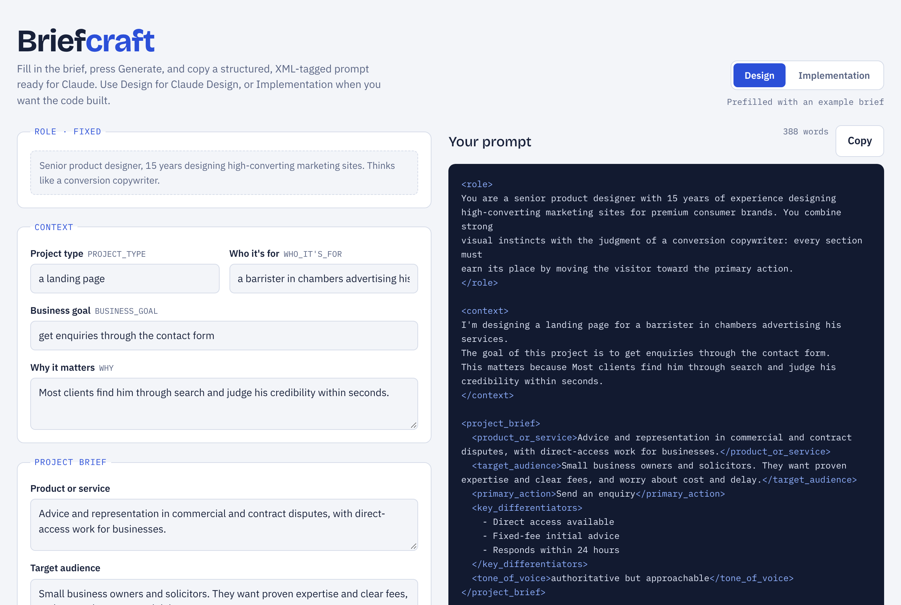

# Briefcraft: a free Claude prompt generator for website and landing page briefs

**[Open Briefcraft](https://adam-ali.github.io/Briefcraft/)** (free, runs in your browser, no sign-up)

Briefcraft turns a simple form into a well-structured prompt you can paste into Claude. It's a prompt builder for anyone who wants better results from Claude when designing or building a website or landing page.

Writing a good prompt for a website or landing page means remembering a lot: who it's for, what the goal is, what tone to use, what the constraints are. Briefcraft asks for those things one by one, then builds a clear, organised prompt for you.

## What it does

1. You fill in a short form about your project (who it's for, the goal, the audience, the tone, the style, any constraints).
2. You press **Generate prompt**.
3. Briefcraft shows a finished prompt on the right, laid out with XML-style tags (`<role>`, `<context>`, `<project_brief>` and so on) that Claude understands well.
4. You press **Copy** and paste it into Claude.

## Two modes

- **Design**: for tools like Claude Design. The prompt asks for a plan, page copy and a full visual design (desktop and mobile). It includes optional colour palette and layout fields.
- **Implementation**: for when you want the site actually built. The prompt also asks for working code, and adds fields for your tech stack, hosting and integrations. Responsive layout, accessibility, speed and SEO are always included.

Use the toggle at the top right to switch.

## How to use it

Briefcraft is a single file with no build step and nothing to install.

- **Online:** open [adam-ali.github.io/Briefcraft](https://adam-ali.github.io/Briefcraft/).
- **Locally:** download `index.html` and open it in any modern browser.

The form starts with an example brief so you can see how it works. Press **Clear form** to start fresh.

## Privacy

Everything runs in your browser. Nothing you type is sent anywhere. Your draft and chosen mode are saved in your browser's local storage so they're still there next time; clearing your browser data removes them. The only network request is loading fonts from Google Fonts, and the page still works without it.

## Project files

- `index.html`: the whole app (HTML, CSS and JavaScript in one file)
- `assets/screenshot.png`: the screenshot above, also used for link previews
- `robots.txt` and `sitemap.xml`: help search engines find the page
- `LICENSE`: MIT license
- `README.md`: this file

## License

Released under the [MIT License](LICENSE). You're free to use, copy, change and share it.

## Keywords

Claude prompt generator, AI prompt builder, prompt engineering tool, XML prompt template, landing page prompt, website design brief, Claude Design, structured prompts.
